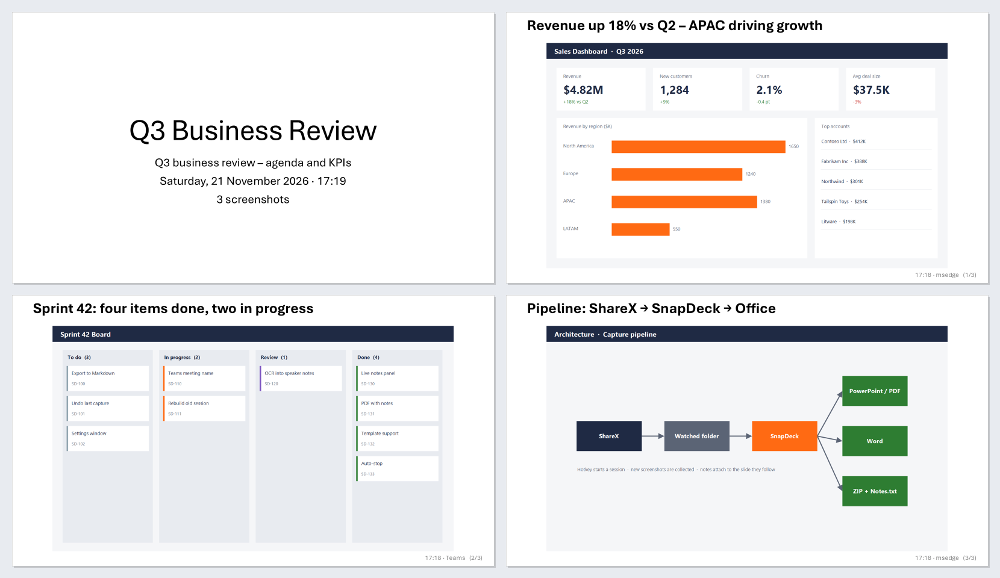
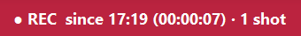
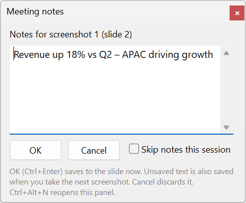
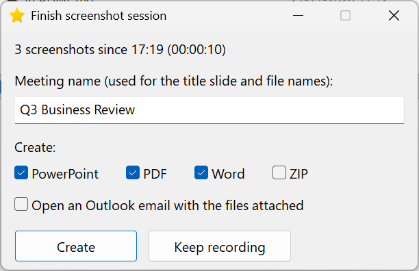
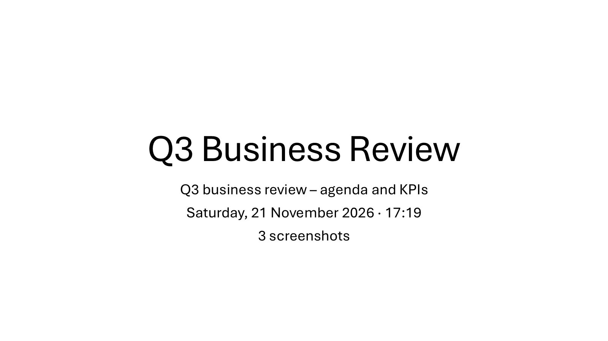
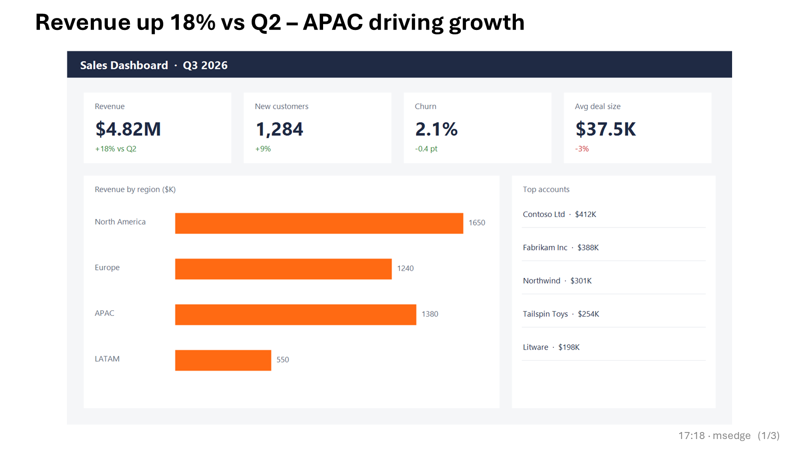

# SnapDeck

**Hotkey-driven screenshot sessions for [ShareX](https://getsharex.com) → PowerPoint, PDF, Word or ZIP, with live notes.**

Press a hotkey when a meeting starts, take screenshots with ShareX as usual, jot notes as you go, and press another hotkey when you're done. SnapDeck collects every screenshot from that session and builds a deck: a title slide, one screenshot per slide with your note as the heading, and a closing slide.

Built with [AutoHotkey v2](https://www.autohotkey.com). Windows only.



<p align="center"><em>A deck built from one session. Each note becomes the slide heading; captions show the time, source app and position.</em></p>

## Screenshots

| While recording | When you finish |
|---|---|
| **REC badge** (bottom-right, kept out of captures)<br><br><br>**Live notes panel**<br> | **Finish dialog**: name the meeting, pick formats, optionally draft an email<br> |

<details>
<summary>Individual slides</summary>




</details>

## Features

- **One hotkey to start, one to finish.** Only screenshots taken during the session are collected.
- **Works with your existing ShareX hotkeys:** region, full screen, window; anything ShareX saves to disk.
- **Live notes panel.** Type while you capture. Notes are attached to the screenshot they follow and appear as the slide heading. They also go into the speaker notes, Word and `Notes.txt`.
- **Several outputs:** PowerPoint, PDF, Word and ZIP, alone or in any combination.
- **Uses your template.** Point it at a `.potx` or `.pptx` and it uses that template's title, blank and closing layouts, plus its logo in the footer.
- **On-screen REC badge** shows the start time, elapsed time and number of screenshots. The badge and notes panel are kept out of your screenshots.
- **Auto-stop** after a configurable number of minutes (default 60).
- **Optional Outlook draft** with the files attached. It is never sent automatically.
- **Captions** on each slide show the time and source app, e.g. `15:58 · msedge (2/5)`.

## Requirements

| | |
|---|---|
| Windows | 10 (2004 or later) or 11 |
| [AutoHotkey](https://www.autohotkey.com) | v2.0+ |
| [ShareX](https://getsharex.com) | with **After capture → Save image to file** enabled |
| Microsoft PowerPoint | for PowerPoint and PDF output |
| Microsoft Word | for Word output |
| Classic Outlook | only for the optional email draft (the new Outlook has no automation support) |

ZIP output and `Notes.txt` work without Office.

## Install

1. Install AutoHotkey v2 and ShareX.
2. Download `SnapDeck.ahk` into any folder.
3. Double-click it. A tray icon appears, and `SnapDeck.ini` is created next to the script.
4. *(Optional)* To start it at login, press <kbd>Win</kbd>+<kbd>R</kbd>, type `shell:startup`, and put a shortcut to `SnapDeck.ahk` in the folder that opens.

## Usage

| Hotkey | Action |
|---|---|
| <kbd>Ctrl</kbd>+<kbd>Alt</kbd>+<kbd>S</kbd> | Start a session |
| ShareX hotkeys | Take screenshots as usual |
| <kbd>Ctrl</kbd>+<kbd>Alt</kbd>+<kbd>N</kbd> | Show or focus the notes panel |
| <kbd>Ctrl</kbd>+<kbd>Enter</kbd> (in the panel) | Save the note to the current slide |
| <kbd>Ctrl</kbd>+<kbd>Alt</kbd>+<kbd>E</kbd> | Stop: opens the finish dialog (name, formats, email) |
| <kbd>Ctrl</kbd>+<kbd>Alt</kbd>+<kbd>P</kbd> / <kbd>W</kbd> / <kbd>Z</kbd> | Finish dialog with PowerPoint / Word / ZIP pre-ticked |

The same actions are in the tray icon's menu.

### Notes panel

- Text typed **before the first screenshot** goes on the title slide.
- After that, text belongs to the **most recent screenshot**. It is saved when you click **OK**, press **Ctrl+Enter**, or take the next screenshot.
- **Cancel** discards the text. **Skip notes this session** hides the panel; **Ctrl+Alt+N** brings it back.

### Output

```
Documents\SnapDeck\
└── Client sync\
    ├── 001_msedge_1BzIw7DZIa.png
    ├── 002_Teams_i40WgwOV1J.png
    ├── Notes.txt
    ├── Client sync.pptx
    ├── Client sync.pdf
    └── Client sync.docx
    Client sync.zip
```

If a folder with that name already exists, the new one is named `Client sync (2)`.

## Settings

Edit `SnapDeck.ini` (tray → **Settings → Edit settings file**), or use the tray **Settings** menu. See [`settings.example.ini`](settings.example.ini) for every option.

| Key | Default | Meaning |
|---|---|---|
| `ShareXFolder` | `Documents\ShareX\Screenshots` | Folder ShareX saves to (subfolders are included) |
| `OutputFolder` | `Documents\SnapDeck` | Where session folders are created |
| `Mode` | `Move` | `Move` or `Copy` screenshots out of the ShareX folder |
| `AutoStopMinutes` | `60` | Auto-stop after N minutes (`0` = never) |
| `AutoStopFormats` | `pptx` | Formats built on auto-stop (`pptx,pdf,docx,zip`) |
| `Template` | *(empty)* | `.potx`/`.pptx` to use as the deck design |
| `Captions` | `1` | Time and app caption on each slide |
| `ShowBadge` | `1` | On-screen REC badge |
| `NotesPanel` | `1` | Open the notes panel when a session starts |
| `NotesOnSlide` | `1` | Show notes as the slide heading (`0` = speaker notes only) |

To change the hotkeys, edit the `^!s`, `^!e`, … lines near the top of the script (`^` = Ctrl, `!` = Alt, `+` = Shift).

## Known limitations

- **PowerPoint can't save straight into OneDrive-synced folders.** SnapDeck saves to `%TEMP%` and then moves the file into place, so this is handled for you.
- **The email draft needs classic Outlook.** The new Outlook app can't be automated.
- **The app name in captions comes from ShareX's default file name pattern** (`%pn_%ra{10}`). With a different pattern the caption shows only the time.
- **Keeping the badge and panel out of screenshots** relies on `SetWindowDisplayAffinity` (Windows 10 2004+).

## Roadmap

See [TODO.md](TODO.md).

## Licence

[MIT](LICENSE)
